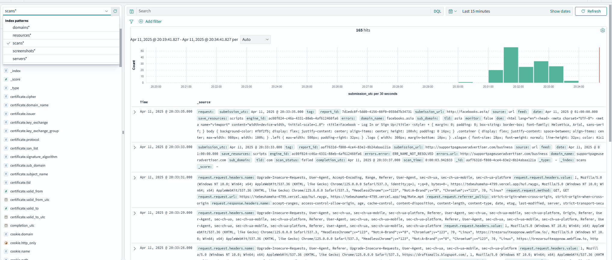

# Webamon Sandbox Stack - Open-source Private URL & Domain Scanner

## Overview

Webamon provides a self-hosted stack for **comprehensive web scans** of URLs and domains. It is a private sandbox that
renders each page in a real browser and records what it does:

*   **Page content:** the rendered DOM, page title, links and scripts.
*   **Network activity:** every request and response (headers, status, timings, IPs), cookies and TLS certificates.
*   **Technology detection:** the frameworks, servers and services a page uses.
*   **Resources:** each loaded JS, CSS or other file, deduplicated by SHA-256.
*   **Fingerprints:** content hashes that cluster pages built from the same kit, even across unrelated domains.
*   **Screenshots:** optional.

Scans are enriched with DNS records, IP geolocation and ASN data, then stored in OpenSearch for searching, pivoting
and visualisation in OpenSearch Dashboards.

## What's new in this version

The scanner has been rebuilt on **Playwright** with an async engine. Compared with the previous Selenium version:

*   **Faster and lighter:** a pool of long-lived browser processes, each scan in a fresh isolated browser context, and
    batched writes to OpenSearch instead of hundreds of single requests per scan.
*   **Page fingerprints:** `fingerprint.dom`, `dom_structure`, `dom_band` (fuzzy, survives small edits), `links`,
    `scripts`, `ssl`, `cookies` and more, plus favicon hashes (`favicons.mmh3`). Search one hash to find every page
    built from the same kit.
*   **Safer to run:** private and internal network targets are blocked (SSRF guard), and every scan has a deadline and
    memory limits so a hostile page cannot hang or exhaust a worker.
*   **Correct entity history:** `domains` and `servers` are single indices where first-seen and last-seen accumulate.
*   **Simpler setup:** GeoIP databases download at run time with MaxMind's own updater, and nothing secret is baked
    into the image.
*   **FastAPI endpoint:** same `POST /scan` contract as before, with optional API-key auth and a `/healthz` status.

## Prerequisites

*   **Docker and Docker Compose.**
*   **About 6 GB of free memory** (OpenSearch takes 2 GB, the scanner up to 3 GB by default).
*   **A MaxMind GeoLite2 account (optional)** for country and ASN enrichment. Sign up free at
    [maxmind.com](https://www.maxmind.com/en/geolite2/signup) for an **Account ID** and **License Key**.

## Getting started

1.  **Clone the repository:**
    ```bash
    git clone https://github.com/webamon-org/webamon.git
    cd webamon
    ```

2.  **Configure:**
    ```bash
    cp .env.example .env
    ```
    Set `OPENSEARCH_ADMIN_PASSWORD` in `.env`. OpenSearch requires a strong password: at least 8 characters with
    upper and lower case letters, a digit and a special character. Add `MAXMIND_ACCOUNT_ID` and
    `MAXMIND_LICENSE_KEY` if you have them.

3.  **Build and start the stack:**
    ```bash
    docker compose up --build -d
    ```
    The first start takes a few minutes while images download. The scanner is ready when
    `curl http://localhost:5000/healthz` returns `"status": "ok"`.

## Usage

Submit scans with `scan.py`, which calls the scanner's API at `http://localhost:5000/scan`:

```bash
python3 scan.py -u example.com               # one URL
python3 scan.py -f ./test/openphish.txt      # one URL per line
```

If you set `SANDBOX_API_KEY` in `.env`, pass it with `-k` (or the `SANDBOX_API_KEY` environment variable).

Or call the API directly:

```bash
curl -X POST http://localhost:5000/scan -H "Content-Type: application/json" \
     -d '{"submission_url": "example.com"}'
```

The response returns the `report_id` and `scan_status`.

### Configuration

Every scanner setting is an environment variable; the common ones are in `.env.example` and `docker-compose.yml`, and
the full list with explanations is in [`sandbox/sandbox/config.py`](sandbox/sandbox/config.py). Highlights:

| Setting | Default | What it does |
|---|---|---|
| `THREADS` | 4 | Concurrent scans per container (budget about 250 MB of memory each) |
| `SCAN_TIMEOUT` | 30 | Seconds to wait for a page to load |
| `POST_LOAD_DWELL_MS` | 0 | Keep capturing after load, to catch lazily loaded requests |
| `DNS` | ALL | `ALL` resolves every domain on the page, `MAIN` only the page's own, `NONE` skips DNS |
| `SAVE_SCREENSHOT` | False | Store a screenshot of each page |
| `SAVE_RESOURCES` | True | Store loaded scripts and files in the `resources` index |
| `FAVICON_HASHING` | True | Hash favicons for pivoting (`favicons.mmh3`) |

## Accessing data

*   **OpenSearch Dashboards:** [http://localhost:5601](http://localhost:5601). Log in as `admin` with your
    `OPENSEARCH_ADMIN_PASSWORD`. Index patterns for all the indices below are created automatically.
*   **OpenSearch API:** `https://localhost:9200` (self-signed certificate).

Both are bound to `127.0.0.1`, so they are only reachable from the machine running the stack.

**Indices:**

*   `scans-YYYY.MM.DD`: one document per scan, with requests, certificates, technologies, fingerprints and DNS.
*   `resources-YYYY.MM.DD`: files loaded by scanned pages, keyed by SHA-256.
*   `domains`: every domain seen, with first and last seen times.
*   `servers`: every server IP seen, with ASN and country.
*   `screenshots-YYYY.MM.DD`: screenshots, when enabled.

**Example queries** (in Dashboards Discover, on `scans-*`):

*   `page_title:"Sign in"` finds login pages.
*   `fingerprint.dom_structure:<hash>` finds every page built from the same template.
*   `server.ip:"203.0.113.10"` finds everything hosted on one IP.



## Running the tests

```bash
pip install -r sandbox/requirements.txt pytest pytest-asyncio
pytest
```

## Contributing

Contributions are welcome! Please feel free to submit pull requests or open issues.
